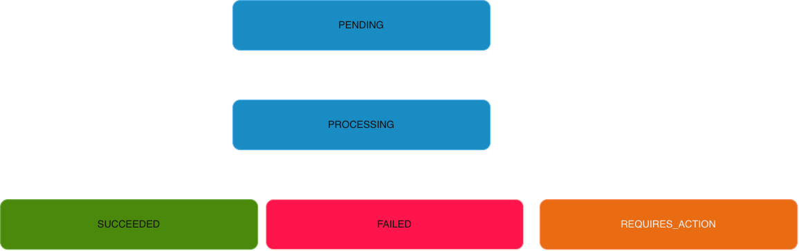

## Payment Workflow

# Description
When a request is created, the default state is 'PENDING'. When it is being acted upon, the state changes to 'PROCESSING'. When the processing is complate, it is moved to "SUCCEEDED" if all goes well, or "FAILED" if any of relevant operations involved fails. Or it can move to "REQUIRES_ACTION" if there is something to be done at the payment processor end. We

# Concerns
1. When the provider times out, we move the record to "UNKNOWN". The recovery process should include:
 - Querying the PSP using the provider transaction reference.
 - Processing provider webhooks.
 - Manual reconciliation against provider records.
 - Retrying only when it is safe to do so
2. We distingish between failed payment and unkown payment outcome based on the status.
3. When a payment has multiple attempts, making the operation idempotency protects us from duplication of requests.
4. When the webhook is arrives before then provider response, we take the following steps:
    - Persist incoming provider webhook events.
    - Deduplicate them using a provider event identifier.
    - Correlate them with the relevant payment and payment attempt.
    - Apply valid state transitions atomically.
    - Ignore stale or duplicate events safely.
    - Reconcile events that cannot yet be correlated.
5. Ledger posting happens when the status of the payment has changed to "SUCCEEDED". The following guidelines should be ensured:
    - Ledger posting is atomic.
    - Every ledger transaction balances. Meaning total debit must be equal to total credit.
    - A payment cannot produce duplicate ledger postings.
    - Posting has a unique business reference.
    - A failed ledger operation can be retried safely.
    - Payment state changes and event publication cannot silently become inconsistent.

6. Refunds should initiate a new operation returning previously captured funds. Reversal means cancelling or reversing an earlier operation, subject to the provider's capabilities and transaction stage.